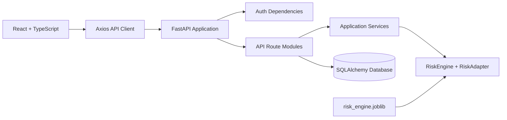
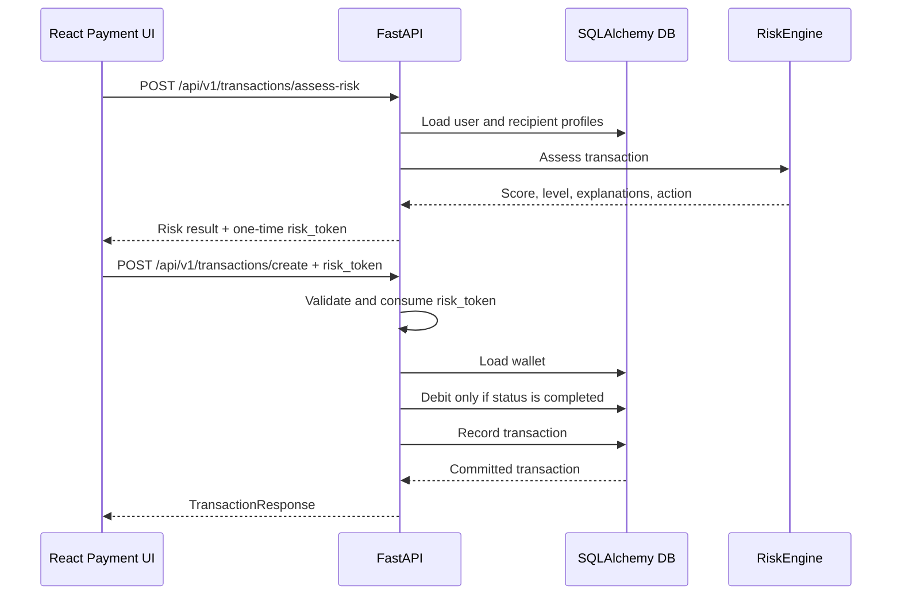
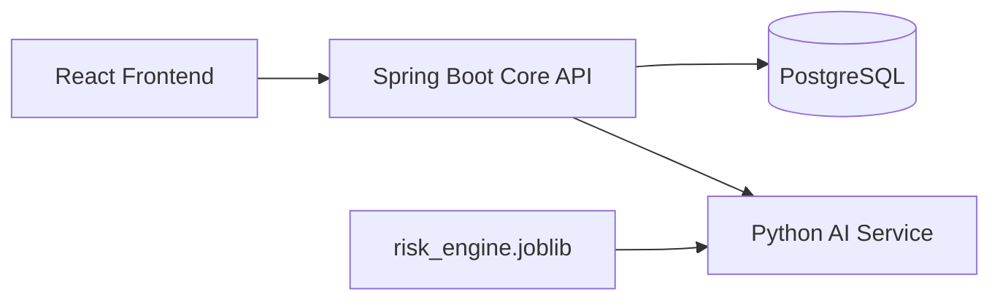

# UPI SafeGuard: Architecture, API, and Design Guide

## 1. Purpose of This Document

This document explains how UPI SafeGuard works today, how the frontend connects to the backend, which design principles and patterns are used, and how the project can evolve toward a Spring Boot core backend with a Python AI service.

The project is a web-based UPI fraud-risk analysis prototype. It does not connect to NPCI or real banks, and it does not process real customer money.

## 2. Architecture Decision Record

### Decision

We will evolve the project into a portfolio-quality system with:

- React and TypeScript for the user interface.
- Spring Boot as the future core business backend.
- Python as a separate AI risk service.
- PostgreSQL for persistent deployed environments.
- SQLite for local demo mode and automated tests.
- Docker Compose for local multi-service development.
- GitHub Actions for backend, AI, frontend, and integration checks.

### Ownership rule

The core backend owns identity, authorization, wallets, transactions, guardians, fraud reports, and database writes.

The Python service owns model loading, risk calculation, explanations, and AI recommendations.

The AI service may recommend `proceed`, `delay`, or `block`, but it must never debit a wallet or write a payment transaction. Only the core backend can make and persist the final payment decision.

### Migration rule

We will not rewrite the working FastAPI application in one large change. The current FastAPI backend remains the working reference until the Spring Boot replacement passes the same API and payment tests.

The migration is contract-first:

1. Define and test the AI HTTP contract.
2. Run the Python AI service independently.
3. Build a core-backend client for that contract.
4. Move business modules to Spring Boot one at a time.
5. Switch the frontend only after the replacement API passes integration tests.
6. Retire old FastAPI business routes only after the new path is proven.

This prevents the project from having two different sources of truth for balances or risk decisions.

### Current status

| Phase | Status | Evidence |
|---|---|---|
| Honest current architecture | Complete | FastAPI, React, SQLAlchemy, RiskEngine documented |
| Python AI service boundary | Complete | `backend/ai_service`, `/health`, `/v1/assess` |
| AI service contract test | Complete | `backend/tests/test_ai_service.py` |
| Core backend HTTP client | Complete | `RiskServiceClient` exists, validates responses, handles errors, and is tested |
| Spring Boot core backend | In progress | Risk proxy skeleton exists; users, wallets, and transactions are not moved yet |
| PostgreSQL production profile | Planned | Current code has PostgreSQL attempt and SQLite fallback |
| Full multi-service deployment | Planned | Docker and CI need final adaptation |

### Definition of done

The project is complete as a portfolio system when:

- A new developer can start the services using documented commands.
- The frontend can log in, assess a payment, create a simulated payment, and view history.
- A blocked payment never changes the wallet balance.
- Spring Boot owns all core payment and database decisions.
- Python responds through a versioned AI API.
- Backend, AI, frontend, and integration tests run in CI.
- Deployment secrets are externalized.
- The README clearly states that this is a simulated fraud-risk prototype.

## 3. Current Architecture

The current runtime is a React/TypeScript frontend connected to one FastAPI backend.



### Current components

| Layer | Location | Responsibility |
|---|---|---|
| Frontend | `frontend/src` | Screens, forms, authentication state, API calls, risk display |
| API entrypoint | `backend/app/main.py` | Creates FastAPI app, middleware, routers, startup/shutdown |
| Routes | `backend/app/api/routes` | HTTP endpoints and request orchestration |
| Schemas | `backend/app/schemas` | Pydantic request and response validation |
| Services | `backend/app/services` | Reusable business and integration logic |
| Database | `backend/app/db` | SQLAlchemy engine, sessions, and ORM models |
| Risk engine | `backend/app/ml/risk_engine.py` | Rules, anomaly detection, graph signals, and risk decision |
| Risk adapter | `backend/app/ml/pipeline/risk_adapter.py` | Stable interface around the risk engine |
| Training | `backend/train_paysim.py` | Creates or trains the model artifact |

## 4. Startup and Dependency Injection

FastAPI uses a lifespan function in `backend/app/main.py`.

At startup it:

1. Initializes the SQLAlchemy database.
2. Initializes optional integrations.
3. Loads `app/ml/trained_models/risk_engine.joblib` once.
4. Falls back to a deterministic `RiskEngine` if the artifact is missing.
5. Stores the engine and adapter on `app.state`.
6. Seeds demo transactions when the database is empty.

The risk dependency is resolved by `get_risk_assessment_service()`:

```python
risk_adapter = request.app.state.risk_adapter
return RiskAssessmentService(risk_adapter)
```

Routes receive the service through `Depends` instead of constructing a new model for every request.

This is the Dependency Injection pattern:

```text
Application startup
    -> create RiskEngine
    -> create RiskAdapter
    -> store shared instance

HTTP request
    -> FastAPI resolves dependency
    -> route receives RiskAssessmentService
    -> service calls RiskAdapter
    -> adapter calls RiskEngine
```

Benefits:

- The model is loaded once.
- Routes do not know how the model is constructed.
- Tests can replace the dependency with a fake service.
- A future Python microservice can replace the adapter boundary.

## 5. Frontend-to-Backend API Connection

The frontend API client is located at:

```text
frontend/src/api/client.ts
```

Axios uses this base URL:

```typescript
baseURL: import.meta.env.VITE_API_BASE_URL || '/api/v1'
```

Therefore this frontend call:

```typescript
api.post('/transactions/assess-risk', data)
```

resolves to:

```text
POST /api/v1/transactions/assess-risk
```

The Axios request interceptor adds:

- `Authorization: Bearer <token>` when a token exists
- `X-Device-Info` for device/session context

The response interceptor redirects the user to login after a `401` response.

### Main transaction flow



### Important transaction rule

The client must assess risk before creating a payment:

```text
assess-risk -> receive risk_token -> create -> debit and record
```

The backend remains authoritative. The frontend never decides whether a wallet debit is allowed.

### Main API endpoints

All paths are prefixed with `/api/v1`.

| Method | Path | Purpose |
|---|---|---|
| POST | `/auth/request-otp` | Generate and deliver an OTP |
| POST | `/auth/verify-otp` | Verify OTP and issue a session token |
| POST | `/auth/register` | Register a user |
| GET | `/auth/me` | Return the authenticated user |
| POST | `/transactions/assess-risk` | Assess a transaction before payment |
| POST | `/transactions/create` | Create, debit, and record a transaction |
| GET | `/transactions/history?page=1&page_size=20` | Return paginated user history |
| POST | `/transactions/check-recipient` | Check recipient safety |
| POST | `/fraud/report` | Submit a fraud report |
| POST | `/guardian/setup` | Configure guardian mode |
| GET | `/guardian/pending-approvals` | List pending guardian approvals |
| POST | `/intervention/check` | Check whether an intervention is required |
| POST | `/intervention/resolve` | Resolve an intervention |
| GET | `/admin/dashboard/overview` | Admin dashboard metrics |

Swagger documentation is available at:

```text
http://localhost:8000/docs
```

## 6. Risk Assessment Design

The runtime uses one `RiskEngine`. It is not a five-model ensemble.

The engine combines:

1. Hard rules, such as known fraud reports or very large amounts.
2. Isolation Forest-compatible anomaly signals.
3. Graph-based recipient and fraud-ring signals.
4. User profile and recipient profile features.
5. Context such as active calls, transaction time, amount, and recipient novelty.

The engine returns:

```json
{
  "risk_level": "low",
  "risk_score": 0.12,
  "recommended_action": "proceed",
  "require_guardian_approval": false,
  "risk_factors": [
    "Transaction looks consistent with the user and recipient profiles"
  ],
  "model_versions": {
    "risk_engine": "risk-engine-v1",
    "isolation_forest": "heuristic-compatible",
    "gnn": "heuristic-compatible"
  }
}
```

Risk policy is enforced by the transaction route:

| Risk outcome | Transaction behavior |
|---|---|
| `proceed` | Debit wallet and save completed transaction |
| `delay` | Continue through review or guardian policy |
| `block` | Save blocked transaction without debiting wallet |

The Python engine recommends an action. The backend controls the wallet and database transaction.

## 7. Database and Schema

The project uses SQLAlchemy ORM models defined in:

```text
backend/app/db/models.py
```

The current connection behavior is:

- Attempt PostgreSQL when configured and reachable.
- Fall back to local SQLite demo mode when PostgreSQL is unavailable.
- Use `AsyncSession` and `async_sessionmaker`.
- Create tables at startup for the prototype.
- Apply a limited SQLite missing-column migration helper.

For a deployed production system, use PostgreSQL with formal migrations instead of relying on startup table creation and the prototype auto-migration helper.

### Main entities

```mermaid
erDiagram
    USER ||--o| WALLET : owns
    USER ||--o{ TRANSACTION : creates
    USER ||--o{ GUARDIAN : configures
    USER ||--o{ CHALLENGE_PROGRESS : completes
    USER ||--o{ FRAUD_REPORT : submits

    USER {
        uuid id PK
        string phone_number UK
        string full_name
        string email
        string upi_id UK
        string firebase_uid UK
        float security_score
        decimal daily_limit
        boolean guardian_enabled
    }

    WALLET {
        uuid id PK
        uuid user_id FK UK
        decimal balance
        decimal daily_limit
        decimal daily_spent
        string currency
    }

    TRANSACTION {
        uuid id PK
        uuid user_id FK
        string recipient_upi
        decimal amount
        string status
        string risk_level
        float risk_score
        json risk_factors
        boolean guardian_approval_required
        datetime created_at
    }

    GUARDIAN {
        uuid id PK
        uuid user_id FK
        uuid guardian_id FK
        string guardian_phone
        string status
    }

    FRAUD_REPORT {
        uuid id PK
        uuid reporter_id FK
        string scammer_upi
        string scam_type
        decimal amount_lost
        string status
    }
```

### Important tables

#### `users`

Stores identity, authentication linkage, risk profile, limits, language, and guardian settings.

#### `wallets`

Stores the simulated balance. There is one wallet per user. The wallet is the authoritative balance source for the prototype.

#### `transactions`

Stores the payment request, risk result, status, amount, recipient, guardian state, and timestamps.

#### `fraud_reports`

Stores community reports about suspicious UPI IDs and evidence metadata.

#### `guardians`

Stores the relationship between a user and a guardian who may approve risky transactions.

#### `challenges` and `challenge_progress`

Store security education content and the user's challenge results.

### Data types and portability

The models define custom types:

- `GUID`: PostgreSQL UUID or SQLite `CHAR(36)`.
- `JSONType`: PostgreSQL JSONB or SQLite text containing JSON.
- SQLAlchemy `Enum`: used for user literacy, transaction status, and risk level.
- `Numeric`: used for money-like values such as wallet balances and transaction amounts.

Money values should remain decimal or numeric in the database. Do not use binary floating point for authoritative balance arithmetic in a production migration.

## 8. Design Principles

### Single source of truth

Wallet balance and transaction status are controlled by the backend database. The frontend is a view, not the authority.

### Separation of concerns

- Routes handle HTTP concerns.
- Services handle reusable application logic.
- Schemas validate API data.
- Models represent persistence.
- The risk engine calculates risk.

### Explicit boundaries

Risk assessment and payment creation are separate endpoints. This makes the flow inspectable and allows the backend to require a short-lived risk token.

### Fail closed for money movement

A risk assessment failure, invalid token, missing user, or insufficient balance must not result in a wallet debit.

### Dependency inversion

Routes depend on `RiskAssessmentService`, not directly on model construction. The service depends on `RiskAdapter`, which depends on the engine.

### Honest capability boundaries

The project does not claim real bank integration, NPCI connectivity, real customer data, or unsupported ML models.

## 9. Design Patterns Used

### Dependency Injection

FastAPI `Depends` supplies database sessions, authenticated user IDs, and the risk service.

### Adapter Pattern

`RiskAdapter` provides a stable interface around `RiskEngine` and normalizes the result shape for the rest of the application.

### Service Layer Pattern

`RiskAssessmentService`, OTP services, notification services, and fraud services keep reusable logic out of route functions.

### Repository-like data access

The current routes use SQLAlchemy `select()` queries directly. This is acceptable for the prototype. A larger Spring Boot migration should introduce repositories such as `UserRepository`, `WalletRepository`, and `TransactionRepository`.

### Strategy-like risk signals

The engine combines separate signal providers, including anomaly and graph analysis, behind a common assessment flow. New signal providers can be added without changing the API contract.

### Unit of Work behavior

The SQLAlchemy session groups wallet mutation and transaction insertion into one commit. If the payment cannot be completed, the session is rolled back and no debit is persisted.

## 10. Current Limitations

- The backend is currently FastAPI, not Spring Boot.
- PostgreSQL is attempted, but SQLite is used when PostgreSQL is unavailable.
- MongoDB and Redis functions are safe no-ops in the current demo path.
- The risk engine is a prototype and should not be used for real financial decisions.
- Startup table creation is not a replacement for Alembic migrations.
- Hosted SQLite may lose data if the platform uses ephemeral storage.
- The frontend and backend should eventually have contract tests.

## 11. First Implemented Migration Step: Standalone Python AI Service

The first step toward the Spring Boot/Python architecture is now implemented in:

```text
backend/ai_service/
```

This is a small FastAPI service that owns model inference only. It uses the existing `RiskEngine`, but exposes it through a clean HTTP boundary that a future Spring Boot backend can call.

### What this service does

- Loads `risk_engine.joblib` once when the process starts.
- Falls back to `RiskEngine()` if the artifact is unavailable.
- Accepts transaction, user, and recipient data.
- Returns risk level, risk score, recommendation, explanations, and model version.
- Provides a health endpoint.

### What this service does not do

- It does not authenticate users.
- It does not read or write wallets.
- It does not debit balances.
- It does not save transactions.
- It does not decide database transaction boundaries.

This separation is intentional. A model should recommend a risk action, but it should not directly control money movement.

### Run the AI service locally

From the `backend` directory:

```powershell
python -m uvicorn ai_service.main:app --reload --port 8001
```

The service documentation is available at:

```text
http://localhost:8001/docs
```

### Check service health

```powershell
Invoke-RestMethod http://localhost:8001/health
```

Expected shape:

```json
{
    "status": "ok",
    "service": "risk-service-v1",
    "engine_loaded": true
}
```

### Call the assessment endpoint

```powershell
$body = @{
    transaction = @{
        transaction_id = "demo-transaction-1"
        recipient_upi = "merchant@upi"
        amount = 300
        hour_of_day = 12
        day_of_week = 2
        is_new_recipient = $false
    }
    user_profile = @{
        id = "demo-user-1"
        avg_transaction_amount = 500
        max_transaction_amount = 1000
        total_transactions = 10
    }
    recipient_profile = @{
        trust_score = 90
        report_count = 0
        account_age_days = 365
    }
} | ConvertTo-Json -Depth 5

Invoke-RestMethod `
    -Method Post `
    -Uri http://localhost:8001/v1/assess `
    -ContentType "application/json" `
    -Body $body
```

The response is a contract. A contract means that callers depend on the documented fields, not on Python classes or internal model details.

```json
{
    "service_version": "risk-service-v1",
    "engine_version": "risk-engine-v1",
    "transaction_id": "demo-transaction-1",
    "risk_level": "low",
    "risk_score": 0.12,
    "recommended_action": "proceed",
    "require_guardian_approval": false,
    "risk_factors": [],
    "confidence": 0.76,
    "model_versions": {}
}
```

### Why the service uses HTTP

HTTP creates a clear boundary between two applications:

```text
Spring Boot sends JSON
        -> Python validates JSON
        -> Python runs RiskEngine
        -> Python sends JSON response
```

Spring Boot does not need to import Python code. Python does not need to know how Spring Boot stores users or wallets. Each application can be tested and deployed independently.

### Current and future request path

During the transition, the existing FastAPI application still calls the engine in-process:

```text
Current: FastAPI route -> RiskAssessmentService -> RiskAdapter -> RiskEngine
```

After the Spring Boot migration, the target path is:

```text
Target: Spring Boot route -> Python HTTP client -> Python AI service -> RiskEngine
```

The wallet and transaction database logic should move only to Spring Boot after the new contract has integration tests.

### Core backend client

The reusable client is located at:

```text
backend/app/services/risk_service_client.py
```

It is the bridge between a core backend and the Python AI service. It:

1. Sends JSON to `/v1/assess`.
2. Validates the JSON response with `RiskServiceResult`.
3. Uses a configurable timeout.
4. Converts HTTP errors and invalid responses into `RiskServiceUnavailable`.

The configuration values are:

```text
AI_SERVICE_URL=http://localhost:8001
AI_SERVICE_TIMEOUT_SECONDS=3.0
```

The client is tested with `httpx.MockTransport`, so tests do not need a running network service.

The client is now wired behind `USE_REMOTE_RISK_SERVICE`, which defaults to `false`. This means the current in-process engine remains the default while the remote path can be tested deliberately.

To enable remote inference locally:

```text
USE_REMOTE_RISK_SERVICE=true
AI_SERVICE_URL=http://localhost:8001
AI_SERVICE_TIMEOUT_SECONDS=3.0
```

Remote errors are not silently replaced with a local score. They raise `RiskServiceUnavailable`, so the payment cannot continue with an unknown risk result. This is the fail-closed rule for money movement.

### Two-process integration test

The repository includes an opt-in test for a real running AI service:

```text
backend/tests/test_ai_service_integration.py
```

The test is skipped during the normal suite because it requires a service listening on port `8001`. To run it:

Terminal 1:

```powershell
cd backend
python -m uvicorn ai_service.main:app --host 127.0.0.1 --port 8001
```

Terminal 2:

```powershell
cd backend
$env:RUN_AI_SERVICE_INTEGRATION = "1"
python -m pytest -q tests/test_ai_service_integration.py
```

Docker Compose also starts the AI service separately. In Compose, the core backend receives:

```text
USE_REMOTE_RISK_SERVICE=true
AI_SERVICE_URL=http://ai-service:8001
```

Start the services with:

```powershell
docker compose up --build
```

The service topology is:

```text
frontend:   port 3000
core API:   port 8000
AI service: port 8001
```

The Compose profile is a learning and integration environment. Replace the demo secrets before using it outside a local machine.

## 12. Planned Spring Boot and Python Split

The future portfolio architecture can separate responsibilities like this:



### Spring Boot slice now in the repository

The first Spring Boot project is located at:

```text
core-backend/
```

It currently contains:

- `pom.xml` with Spring Web, validation, Actuator, and test dependencies.
- `CoreBackendApplication` as the application entrypoint.
- `RiskServiceClient` for the Python service call.
- `POST /api/v1/risk/assess` as a temporary risk proxy.
- `application.yml` for the AI service URL and timeout.
- A Dockerfile for a two-stage Maven/JRE image.

Run it after installing Maven:

```powershell
cd core-backend
mvn spring-boot:run
```

It listens on port `8080` by default. In Docker Compose it is exposed on host port `8081` and calls the AI service at `http://ai-service:8001`.

This service is intentionally not connected to the frontend yet. It does not own users, wallets, transactions, or database writes. This prevents two backends from competing to update balances while the migration is still being tested.

The next Spring Boot implementation step is to port the user and wallet domain behind repositories and services, then port the atomic debit tests before changing the frontend base URL.

### Spring Boot would own

- Authentication and authorization
- Users and wallets
- Transactions and atomic payment policy
- Guardian approvals
- Fraud reports
- Admin APIs
- Database transactions
- Audit logs

### Python would own

- RiskEngine
- Model loading
- Isolation Forest and graph analysis
- Risk explanations
- Intervention recommendations
- Training and evaluation scripts

Spring Boot would call Python through a versioned internal API such as:

```http
POST http://risk-service:8001/v1/assess
```

Python would return a recommendation. Spring Boot would decide whether the transaction is allowed and would remain the only service permitted to debit a wallet.

### Migration order

1. Stabilize the current FastAPI API and tests.
2. Extract the Python risk engine behind `/v1/assess`.
3. Add a Spring Boot client for that endpoint.
4. Move authentication and users to Spring Boot.
5. Move wallets and transactions to Spring Boot.
6. Keep the Python service stateless and focused on inference.
7. Add integration tests across Spring Boot, Python, and the database.
8. Retire the equivalent FastAPI routes only after contract tests pass.

Do not rewrite the entire backend before the API contract and transaction tests are stable.

## 13. Local Development

### Backend

```powershell
cd backend
python -m venv .venv
.\.venv\Scripts\Activate.ps1
pip install -r requirements.txt
python train_paysim.py
uvicorn app.main:app --reload
```

### Frontend

```powershell
cd frontend
npm install
npm run dev
```

### Tests

```powershell
cd backend
python -m pytest -q
```

### Useful URLs

```text
Frontend: http://localhost:5173
Backend:  http://localhost:8000
Swagger:  http://localhost:8000/docs
Health:   http://localhost:8000/health
```

## 14. Step-by-Step Project Plan

This is the recommended order. Each step has a reason and a completion check.

### Step 1: Stabilize the current application

**Goal:** Keep the current FastAPI version working while the architecture changes.

**Work:**

- Keep `main` as the canonical branch.
- Keep the existing transaction, wallet, OTP, and risk tests passing.
- Keep frontend API paths aligned with backend paths.

**Check:**

```powershell
cd backend
python -m pytest -q
```

### Step 2: Stabilize the AI contract

**Goal:** Make AI output independent from the current backend framework.

**Work:**

- Use `backend/ai_service/main.py`.
- Keep the request and response models in `backend/ai_service/schemas.py`.
- Add tests for normal, suspicious, and known-scammer inputs.
- Version the contract as `/v1/assess`.

**Check:**

```powershell
cd backend
python -m pytest -q tests/test_ai_service.py
```

### Step 3: Add a client boundary in the core backend

**Goal:** Allow a core backend to call Python without importing the model.

**Work:**

- [x] Create `RiskServiceClient`.
- [x] Give it a base URL and timeout from configuration.
- [x] Add timeout and HTTP error handling.
- [x] Add a clear response validation model.
- [x] Add an explicit feature switch for remote risk assessment.
- [x] Test remote and local service modes.
- [x] Keep remote errors from producing a wallet debit.
- [ ] Add an integration test using two running services.

**Check:** Test a fake AI service response and an AI timeout.

### Step 4: Move core business ownership to Spring Boot

**Goal:** Make Spring Boot the authority for users, wallets, and transactions.

**Work order:**

1. Authentication and user profiles.
2. Wallet repository and balance operations.
3. Transaction service and atomic debit.
4. Guardian approval workflow.
5. Fraud reports and admin APIs.

**Check:** The same wallet tests pass against Spring Boot and the database.

### Step 5: Connect the frontend to the core API

**Goal:** Keep React independent of whether the core backend is FastAPI or Spring Boot.

**Work:**

- Keep API paths stable.
- Configure `VITE_API_BASE_URL` per environment.
- Keep authentication headers in one Axios interceptor.
- Add frontend API error and loading states.

**Check:** The browser can assess risk, create a simulated payment, and display history.

### Step 6: Deploy and document

**Goal:** Make the project demonstrable as a portfolio application.

**Work:**

- Add Docker Compose for frontend, core backend, AI service, and database.
- Add CI for Python tests, Java tests, and frontend build.
- Use secrets instead of committed passwords.
- Use PostgreSQL for persistent hosted data.
- Add screenshots and a short demo video.

**Check:** A new developer can clone the repository, follow the README, run the stack, and understand the architecture.

## 15. Portfolio Completion Checklist

- [ ] Keep `main` as the canonical branch.
- [ ] Rewrite the root README with the honest architecture.
- [ ] Keep API paths consistent between frontend and backend.
- [ ] Add frontend build validation to CI.
- [ ] Add API integration tests for assess, create, history, and authentication.
- [ ] Replace prototype startup table creation with Alembic before production deployment.
- [ ] Move production secrets to platform secret storage.
- [ ] Use PostgreSQL for a persistent hosted deployment.
- [ ] Add screenshots and a short demo of the complete payment-risk flow.
- [ ] Document the Spring Boot/Python split as a future architecture, not as an already implemented feature.
- [x] Create a standalone Python AI service boundary with `/health` and `/v1/assess`.
- [x] Add a focused AI service contract test.
