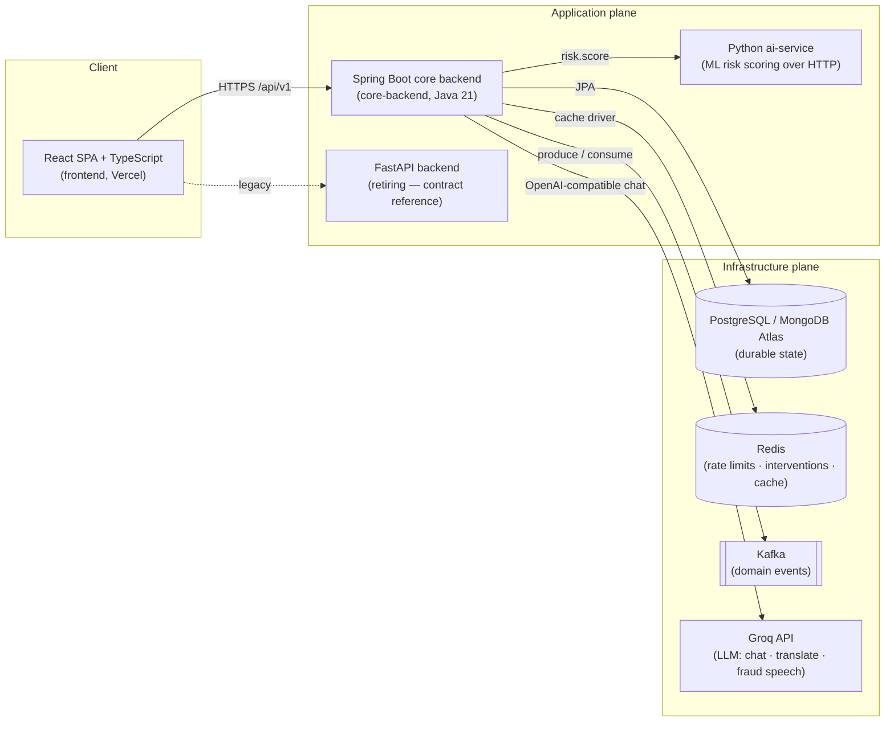
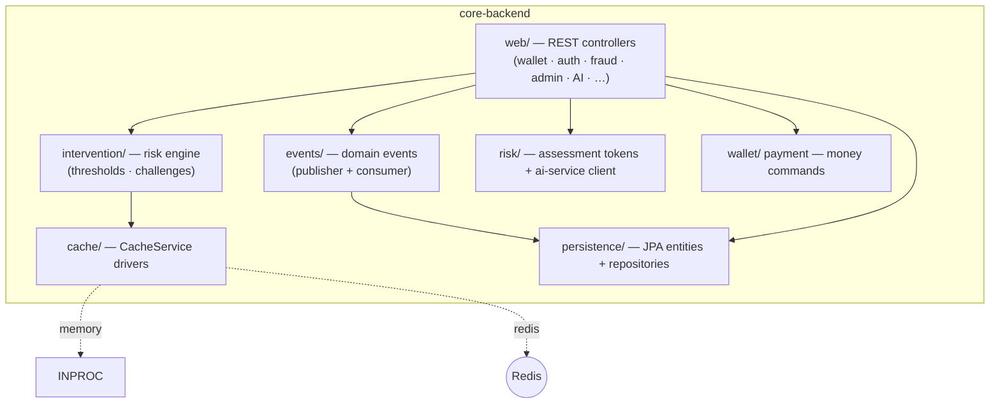
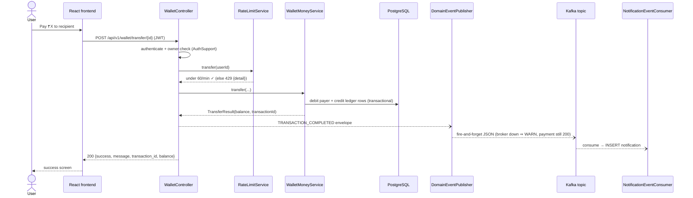
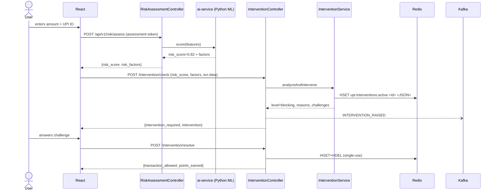
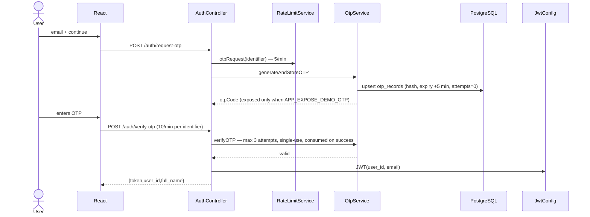

# UPI SafeGuard — System Design

> Architecture, infrastructure (Redis · Kafka · PostgreSQL), request flows, event
> contracts, failure modes, and the deployment topology. This document tracks the
> **Spring Boot core backend** (`core-backend/`) as the production target; the
> Python FastAPI backend (`backend/`) remains the API contract reference.

**Companion files:** [`docs/FULL_STACK_ARCHITECTURE.md`](FULL_STACK_ARCHITECTURE.md) ·
[`docs/PROJECT_ARCHITECTURE_AND_API_GUIDE.md`](PROJECT_ARCHITECTURE_AND_API_GUIDE.md) ·
root [`README.md`](../README.md)

---

## 1. Design principles

| # | Principle | How it shows up in the code |
|---|-----------|-----------------------------|
| 1 | **Parity first** | Every HTTP response mirrors the FastAPI shapes (`{detail}` errors, snake_case) so the React frontend never forks per backend. |
| 2 | **Config-gated infrastructure** | Redis and Kafka are *optional drivers*: `APP_CACHE_DRIVER` and `APP_KAFKA_ENABLED`. Small deployments run with **zero extra infra**; scaled deployments flip two env vars. |
| 3 | **Durable state in PostgreSQL, ephemeral state in cache** | Users, wallets, transactions, fraud reports, notifications, OTP records → Postgres. Rate-limit windows and the active-intervention registry → Redis (or the in-process driver). |
| 4 | **A payment must never fail because streaming failed** | Kafka sends are wrapped: a dead broker logs `WARN` and the transfer still returns 200. Stronger guarantees are on the roadmap (§10). |
| 5 | **Same driver semantics everywhere** | `RedisCacheService` and `InMemoryCacheService` implement one interface, so local dev (memory) and production (Redis) exercise identical code paths. |

---

## 2. System context (birds of the system)



*Production today:* `A → P` (Vercel → Render); the flip to `A → S` is the final
migration step. Every component above is optional per deployment mode (§9).

---

## 3. Component view



| Component | Responsibility | State |
|-----------|----------------|-------|
| `web.WalletController` | Balance/transfer/top-up/history + admin search. Publishes `TRANSACTION_COMPLETED`, guards per-user rate limits. | Postgres + optional Redis |
| `intervention.InterventionService` | 1:1 port of the Python agentic engine: thresholds (0.30/.50/.70/.90), reason ID, challenges, resolve/cancel. Registry in `CacheService`. | Redis hash (shared) or memory |
| `ai.*` | Groq LLM features, temperature 0.3, deterministic fallbacks (config-gated). | stateless |
| `cache.CacheService` | KV + hash + counter primitives with TTLs. | — |
| `services.RateLimitService` | Fixed-window 60 s counters per identity/scope; throws FastAPI-style **429**. | cache |
| `services.OtpService` | 6-digit OTP, 5 min TTL, 3 attempts, persisted in `otp_records` (server-side, survives restarts). | Postgres |
| `events.*` | Publisher (Kafka/no-op) + notification fanout consumer. | Kafka |

---

## 4. Request flows

### 4.1 Payment (happy path) — the golden thread



**Invariants:** balance mutation and the ledger rows commit in one Postgres
transaction; balances never negative; the event is *best-effort* (§10 covers the
outbox upgrade for exactly-once notification delivery).

### 4.2 Fraud intervention — the agentic path



Cross-replica note: because the registry lives in Redis, the replica that
created the intervention need not be the one that resolves it (Python could not
do this — its registry is process-local).

### 4.3 Auth (OTP login) — protected & server-side



### 4.4 Event-driven notifications (fanout)

```
producers: WalletController · FraudController · InterventionController
              └─▶ Kafka ──▶ NotificationEventConsumer (group upi-safeguard-core)
                                └─▶ notifications table ──▶ GET /notifications (JWT)
```

With Kafka disabled the API responses are identical — only the async fanout is
absent (no events are emitted).

---

## 5. Redis design

### 5.1 Driver matrix

| | `memory` (default) | `redis` |
|---|---|---|
| Selected by | `APP_CACHE_DRIVER` unset / `memory` | `APP_CACHE_DRIVER=redis` (+ `REDIS_HOST`, `REDIS_PORT`, `REDIS_PASSWORD`) |
| Scope | per-process (like the Python reference) | cluster-wide, survives restarts |
| Rate limits | per-replica counters | true global counters |
| Intervention registry | per-replica | shared hash — resolve on any replica |
| Tests / CI | ✅ no infra needed | — (container in `docker-compose.yml`) |
| Prod fit | single replica, Render free tier | 2+ replicas, or Upstash/Render Redis |

### 5.2 Keyspace

| Key / pattern | Type | Value | TTL | Purpose |
|---|---|---|---|---|
| `upi:rl:{scope}:{identity}` | string counter | hits in window, `INCR`+`EXPIRE` on first hit | 60 s | rate limiting (§5.3) |
| `upi:interventions:active` | hash | field = `intervention_id` → JSON dump of the intervention | none (unlinked by resolve/cancel) | active interventions, shared across replicas |

**Invariants**

1. Counters are atomic: `INCR` is single-threaded in Redis; the memory driver
   uses `ConcurrentHashMap.compute` per key (same guarantee in-process).
2. Windows are **fixed, 60 s**: the TTL set on first hit resets the window even
   if the caller keeps hitting `INCR` afterwards.
3. Intervention entries are **single-use**: resolve/cancel read *and delete*
   (`HGET`+`HDEL`). Without Lua the two calls are not atomic — the accepted race
   (double resolve returns “not found”) is identical to the Python reference
   behaviour and only benign in outcome (one resolution wins).
4. Nothing in Redis is the source of truth: lose the whole keyspace and the
   platform still works (worst case: a stale intervention needs re-creation,
   plus a rate-limit grace window).

### 5.3 Rate limits

| Scope | Keyed on | Default | Config |
|---|---|---|---|
| `otp_request` | identifier (email/phone, normalised) | 5/min | `RATE_LIMIT_OTP_PER_MINUTE` |
| `otp_verify` | identifier | 10/min | `RATE_LIMIT_OTP_VERIFY_PER_MINUTE` |
| `transfer` | user id (transfers + top-ups) | 60/min | `RATE_LIMIT_TRANSFERS_PER_MINUTE` |
| `fraud_report` | user id | 10/min | `RATE_LIMIT_FRAUD_PER_MINUTE` |

Exceeding the limit yields `429 {"detail": "Too many requests. Please try again
in a minute."}`. `APP_RATE_LIMIT_ENABLED=false` disables all four globally.

### 5.4 Failure modes

| Failure | Behaviour |
|---|---|
| Redis unreachable (driver=redis) | Operations throw → surface as 500s on affected endpoints only; `memory` deployments are unaffected. (Roadmap: fail-open + circuit breaker, §10.) |
| Keyspace flushed | See invariants #4 — no data loss, limiter windows restart. |
| Hot intervention hash | Entries are deleted on resolve; a reaper for abandoned entries (`auto_decline_after_seconds`) is roadmap. |

### 5.5 Sizing note

Rate-limit counters are tiny (≤ a few keys/sec). The intervention hash holds
full-page JSON per active intervention — bounded by *active* interventions, not
history. Redis `maxmemory-policy allkeys-lru` is safe for a cache role but the
intervention hash is more correct under `volatile-lru` since intervention keys
carry no TTL by design.

---

## 6. Kafka design

### 6.1 Topics

| Topic | Keyed by | Producer | Consumer | Config |
|---|---|---|---|---|
| `upi.transactions.completed` | payer `user_id` | WalletController (transfer, top-up) | NotificationEventConsumer | `APP_KAFKA_ENABLED` |
| `upi.fraud.flagged` | reporter `user_id` | FraudController (`/report`) | NotificationEventConsumer | `APP_KAFKA_ENABLED` |
| `upi.interventions.raised` | user id | InterventionController (`/check`) | NotificationEventConsumer | `APP_KAFKA_ENABLED` |

Partitioning: message **key = user id** ⇒ one user's events stay ordered on one
partition (payment → notification ordering preserved); cross-user parallelism
is free. Offsets: consumer group `upi-safeguard-core`, `auto-offset-reset=latest`
(fanout semantics; analytics subscribers would use `earliest` + their own group).

### 6.2 Envelope contract (v1 — stable)

Every message value is JSON:

```json
{
  "event_id": "3f2c9a1e-…",         // UUID, unique per message
  "event_type": "TRANSACTION_COMPLETED",    // one of: TRANSACTION_COMPLETED | FRAUD_REPORTED | INTERVENTION_RAISED
  "occurred_at": "2026-10-23T15:04:05.678Z",  // producer clock (ISO-8601)
  ...payload                        // type-specific fields below
}
```

| Event | Payload fields |
|---|---|
| `TRANSACTION_COMPLETED` | `user_id`, `kind` (`transfer`\|`topup`), `transaction_id`, `amount` (string, 2dp), `recipient_upi`, `recipient_name`, `currency` |
| `FRAUD_REPORTED` | `user_id`, `report_id`, `scammer_upi`, `scam_type`, `amount_lost` |
| `INTERVENTION_RAISED` | `user_id`, `intervention_id`, `transaction_id`, `intervention_level`, `risk_score` |

Schema evolution rule: **additive only** (new optional fields). Consumers must
ignore unknown fields (already true — the consumer routes on `event_type`).

### 6.3 Delivery semantics (current: at-most-once)

* **Producer:** fire-and-forget; exceptions are logged `WARN` and swallowed — a
  Kafka outage **cannot fail a payment** (verified by `EventLayerTest`).
* **Consumer:** auto-commit off; the listener returns before offsets commit, so
  a crash mid-processing can re-deliver → notifications should be *idempotent*,
  not yet dedup (`event_id` dedupe store is on the roadmap).
* **Not yet transactional:** the DB commit and message send happen in different
  resources. The transactional-outbox pattern (§10) is the upgrade when
  notification completeness becomes contractual.

### 6.4 Local broker

`docker-compose.yml` runs a single-node **KRaft** cluster (`apache/kafka:3.9.0`
— no ZooKeeper) with auto topic creation, replication factor 1. Volumes persist
data across compose up/down cycles.

---

## 7. Full-stack deployment topologies

### 7.1 Local development (`docker-compose up`)

| Service | Image / build | Port | Notes |
|---|---|---|---|
| `core-backend` | built `core-backend/Dockerfile` | 8081→8080 | Postgres driver, Redis cache driver, Kafka events **all on** |
| `postgres` | postgres:16-alpine | `${POSTGRES_HOST_PORT:-5433}`→5432 | durable state, volume `postgres-data` |
| `redis` | redis:7-alpine | 6379 → 6379 | AOF append-only, volume |
| `kafka` | apache/kafka:3.9.0 | 9092 → 9092 | single-node KRaft, auto-create topics |
| `ai-service` | built `backend/Dockerfile` | 8001 | ML scoring (`rag: USE_REMOTE_RISK_SERVICE`) |
| `backend` (legacy) | built | 8000 | FastAPI reference/demo, retiring from cloud |
| `frontend` | built | 3000→80 | dev preview (prod runs on Vercel) |

### 7.2 Production (Vercel + Render)

* **Frontend:** Vercel (`frontend/vercel.json` — SPA fallback + `/api/v1` proxy).
* **Backend (current):** FastAPI on Render free tier; DB = Atlas.
* **Backend (target):** core-backend on Render (Dockerfile source) with:
  `DATABASE_URL` (Atlas or managed Postgres), `APP_CACHE_DRIVER=redis`
  (Upstash / Render Key-Value / Memurai), `APP_KAFKA_ENABLED=true` only if a
  managed broker is wired (Confluent / Upstash Kafka); otherwise the platform
  runs identically without them (graceful degradation — principle #2).
* Secrets stay **server-side only**; frontend holds none (JWT per session).

---

## 8. Authentication, authorization, abuse resistance

| Concern | Mechanism |
|---|---|
| Sessions | JWT (`JwtConfig`, HS256) issued after server-side OTP verification; `Authorization: Bearer` on protected routes → `401 {"detail":"Not authenticated"}` parity with FastAPI. |
| Ownership | `AuthSupport.assertOwner` — user-scoped resources reject foreign ids (wallet transfer/top-up). |
| OTP | 6-digit code stored in `otp_records` (parity TODO: hash at rest), 5-minute TTL, **3 attempts max**, single-use, server-persisted. Demo exposure gated by `APP_EXPOSE_DEMO_OTP`. |
| Brute force | OTP request/verify limiters + attempts counter per record. Keyed on identifier, so changing IPs does not reset the budget (Redis ⇒ global). |
| Money-path flood | `transfer`/`fraud_report` limiters (60/min, 10/min per user). |
| Admin | RBAC roles declared in the contract; **enforcement on core-backend is the known open gap** (admin-auth port next, see README roadmap). |

---

## 9. Environment variables (infrastructure plane)

| Variable | Default | Meaning |
|---|---|---|
| `APP_CACHE_DRIVER` | `memory` | `memory` \| `redis` |
| `REDIS_HOST` / `REDIS_PORT` / `REDIS_PASSWORD` | localhost / 6379 / — | Redis connection (docker-compose: `redis`) |
| `APP_RATE_LIMIT_ENABLED` | `true` | global limiter on/off |
| `RATE_LIMIT_OTP_PER_MINUTE` | `5` | OTP requests, per identifier |
| `RATE_LIMIT_OTP_VERIFY_PER_MINUTE` | `10` | OTP verifications, per identifier |
| `RATE_LIMIT_TRANSFERS_PER_MINUTE` | `60` | transfers + top-ups, per user |
| `RATE_LIMIT_FRAUD_PER_MINUTE` | `10` | fraud reports, per user |
| `APP_KAFKA_ENABLED` | `false` | emit domain events + enable consumer fanout |
| `KAFKA_BOOTSTRAP_SERVERS` | `localhost:9092` | broker list (compose: `kafka:9092`) |
| `KAFKA_CONSUMER_GROUP` | `upi-safeguard-core` | consumer group id |

---

## 10. Roadmap (system-design “phase 4+” candidates)

| Item | Driver | Notes |
|---|---|---|
| Transactional outbox | Kafka + DB | Write `outbox` row in the payment transaction; poller publishes → notification delivery becomes **at-least-once** & crash-safe. |
| Redis fail-open circuit-breaker | resilience | When the cache is down: skip limiting + registry lookups vs. 500s; use Resilience4j. |
| `event_id` dedupe store | consumer | `SETNX upi:evt:{event_id}` TTL 24 h → at-most-once notifications. |
| Testcontainers (Postgres/Redis/Kafka) | CI | Full-integration matrix; today the memory driver keeps CI hermetic. |
| Admin portal | product | Full admin surface exists; the missing pieces are admin auth (JWT + roles) and auth-protected CRUD/RBAC. |
| Cache-aside reads | perf | User/wallet read caching with TTL-bounded staleness + invalidation hooks on writes. |
| Streaming analytics | ops | Dashboard topics feed `kafka-connect → warehouse` for ML/monitoring. |
| WebSocket interventions | parity | Realtime push replaces frontend polling (design doc: gateway, token auth, channel-per-user). |
| Multi-AZ Redis + Kafka HA | prod | Managed providers give replication factors ≥ 3. |

---

## 11. Testing matrix

| Suite | Focus |
|---|---|
| `cache.InMemoryCacheServiceTest` | Reference semantics of CacheService (TTL, counters, hashes). |
| `services.RateLimitServiceTest` | Fixed-window behaviour, normalisation, disable switch, 429 contract. |
| `events.EventLayerTest` | Publisher: JSON shapes, topic/key capture, Kafka-outage swallow, no-op fallback; registry survival. |
| `events.NotificationEventConsumerTest` | Event → fanout mapping, unknown-user, garbage input tolerance. |
| `intervention.*` | Agent algorithm 1:1 with Python + HTTP contract (now over the CacheService registry — semantics unchanged). |
| Rest of the 101-test suite | All previous parity behavior — still green under the new drivers. |

Everything runs **hermetically** (no Redis/Kafka needed in CI): the in-memory
drivers and the no-op publisher are the default test configuration by design.
